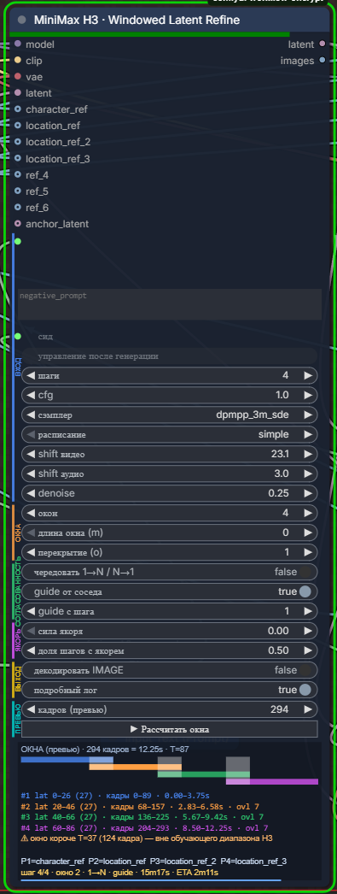

# ComfyUI-H3-WindowedRefine

Нода ComfyUI **MiniMax H3 · Windowed Latent Refine** (`H3WindowedLatentRefine`, категория `MiniMax H3/Refine`). Она дорабатывает готовый AV-латент MiniMax H3 (Ref2VA) для длинных видео: делит его на перекрывающиеся окна и прогоняет за один проход сэмплера.

> **English summary.** A ComfyUI node for MiniMax H3 (Ref2VA) that refines a long audio+video latent with overlapping temporal windows in a single sampler pass. Window order alternates (1→N / N→1), x0 is blended across overlaps, and each window can be guided by its neighbour's overlap (temporal guide via H3 keyframes) and optionally by an anchor latent. It takes character/location reference images, and a canvas preview on the node shows the window layout. Install: `git clone` into `ComfyUI/custom_nodes` and restart ComfyUI. No extra pip dependencies.



## Что умеет
- **Оконный рефайн.** Видеолатент `[B,24,T,H/16,W/16]` (T = 5k+2, то есть 17k+5 кадров) режется на окна по `5m+2` латент-кадров с перекрытием `5o+2`. Окна выровнены по блокам VAE.
- **Один проход сэмплера.** Используется обычный сэмплер ComfyUI с любым `sampler_name`/`scheduler`. Обёртка модели на каждом шаге обходит все окна.
- **Чередование направлений.** Порядок окон меняется от шага к шагу: 1→N, потом N→1. В зонах перекрытия x0 смешивается.
- **Temporal guide.** Окно получает перекрытие от уже обработанного соседа как keyframe H3. Начало задаёт `guide_from_step`.
- **Якорь.** Для части шагов (`anchor_steps`) x0 подмешивается к якорю с силой `anchor_strength`. Якорь — это `anchor_latent` (или исходный латент).
- **Референсы.** Входы `character_ref`, `location_ref`, `location_ref_2`, `location_ref_3`, `ref_4`–`ref_6` (до 9 картинок, батчи раскрываются). В промте на них ссылаются как `<Picture 1>`, `<Picture 2>`, …, нумерация идёт в порядке входов. Таблица соответствия выводится в лог и на ноду.
- **Превью раскладки окон** прямо на ноде, с предупреждениями: число кадров не 17k+5; окно короче T=37 (124 кадра).
- **Вход латента:** AV NestedTensor H3, словарь/кортеж `(video, audio)` или только видео (аудио тогда берётся из `anchor_latent` или создаётся пустое).

## Установка
```bash
cd ComfyUI/custom_nodes
git clone https://github.com/zeroleloushe/ComfyUI-H3-WindowedRefine.git
```
Перезапусти ComfyUI. Дополнительные pip-зависимости не нужны: нода использует torch и модули самого ComfyUI. Нужна сборка ComfyUI с поддержкой MiniMax H3 (Ref2VA).

## Подключение
1. `model` — модель MiniMax H3 Ref2VA (можно с turbo LoRA), `clip` — текстовый энкодер H3 (Qwen3-VL), `vae` — VAE H3.
2. `latent` — готовый латент H3, например результат первого прохода генерации.
3. По желанию подключи картинки к `character_ref` / `location_ref` / `ref_*` и упомяни их в промте как `<Picture N>`.
4. Выход `latent` (AV-латент) отправь в декодер H3. Можно включить `decode` и взять `images` прямо с ноды.

## Параметры
| Параметр | По умолчанию | Описание |
|---|---|---|
| steps | 20 | Число шагов (при denoise<1 выполняется только их часть). Turbo LoRA: 4 |
| cfg | 5.0 | CFG. Turbo LoRA: 1.0 |
| sampler_name | res_multistep (или euler) | Сэмплер |
| scheduler | simple | Расписание шагов |
| shift_video | 12.0 | Flow shift для видео; 0 — не трогать модель |
| shift_audio | 3.0 | Flow shift для аудио |
| denoise | 0.3 | Сила перерисовки |
| num_windows | 2 | Число окон; 0 — размер окна задаёт `window_blocks` |
| window_blocks (m) | 0 | Длина окна 5·m+2 латент-кадров (когда num_windows = 0) |
| overlap_blocks (o) | 2 | Перекрытие 5·o+2 латент-кадров (1 → 7, 2 → 12) |
| alternate_direction | вкл | Чередовать порядок окон 1→N / N→1 |
| temporal_guide | вкл | Подавать соседнее перекрытие как keyframe H3 |
| guide_from_step | 1 | С какого шага (от 0) включается guide |
| anchor_strength | 0.0 | Сила подмешивания якоря |
| anchor_steps | 0.5 | Доля шагов с якорем: round(доля × steps) |
| decode | выкл | Декодировать в IMAGE через VAE (иначе на выходе заглушка 64×64) |
| verbose | вкл | Подробный лог `[H3WR]` в консоли |
| preview_frames | 0 | Кадры для превью окон (только UI); 0 — взять из последнего запуска или 124 |

Выходы: `latent` (AV-латент H3) и `images`.

## Советы
- Окна короче **T=37 (124 кадра)** выходят за обучающий диапазон H3, и превью предупредит об этом. Лучше брать меньше окон, но длиннее.
- Длина клипа должна быть 17k+5 кадров (22, 39, …, 124, 141, …). Иначе нода выдаст ошибку с подсказкой.
- Для начала подойдут denoise 0.3–0.5 и overlap_blocks 1–2.

## Тесты
`pytest` из папки ноды (`tests/`). Скрипт `tools/seam_check.py` проверяет швы между окнами.

## Лицензия
Файла лицензии пока нет.
